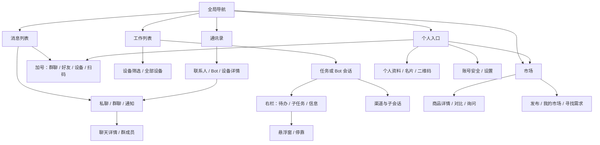

# 全站交互图标与导航层级审计

2026-10-30；依据 `apps/app/src` 当前源码静态盘点。本文是方案和索引，不改产品代码、规范或依赖；桌面、平板、手机位置按源码条件推断，未在本轮逐页实机复验。历史截图与本轮完整交互验收另见 `workbench-mobile-rollout-20261030.md`。

## 判断

统一的是**工具栏骨架和动作归属**：全局导航选模块，模块栏管理当前工作区，会话栏描述当前对象，卡片和输入框保留各自操作。当前工作区的「显示」选择、左右栏开关、悬浮窗和会话操作分散在不同高度；消息、通讯录、市场又分别定义标题、头像和加号，导致相同层级的入口位置不稳定。应统一位置、按钮尺寸、可访问名称和状态，再决定图标；不将所有卡片按钮搬进顶栏。

## 页面导航路线图



## 跨屏动作映射

| 层级 | 桌面 | 平板 | 手机 | 动作与状态 |
|---|---|---|---|---|
| 全局模块 | 左 64px 图标栏：消息、工作、市场、通讯录；底部个人头像 | `Shell` 的 `lg` 以下为底栏，工作区内部另用平板断点 | 一级页底部四栏；会话/联系人详情隐藏底栏 | 导航链接、当前页高亮；不是会话的返回或面板开关 |
| 个人 | 左栏头像进入 `/me`；一级列表头像使用 `PersonalAvatar`，其实际可见性依赖样式 | 一级页头像打开个人菜单 | 一级页左上头像打开全屏个人菜单，X 关闭 | 打开/关闭 dialog；与详情返回互斥，不同时占左侧主槽 |
| 工作模块 | 列表、会话、右栏最多三列；列表栏有收起及设置；会话栏有展开列表、渠道、悬浮窗、右栏 | 至多两列，列表与右栏按空间互斥/覆盖；相同动作按可见性出现 | 一列；会话返回、渠道、悬浮窗、右栏；右栏为全屏 dialog | 左右栏是 toggle；应表达当前开合状态，返回只改变导航层级 |
| 消息与通讯录 | 列表 `ListHeader` 搜索 + 加号，聊天/资料在右侧详情；返回按钮 `lg:hidden` | 小屏列表顶栏头像 + 标题 + 加号，详情用返回 | 同平板布局；详情返回与消息详情菜单 | 搜索是字段，放大镜本身不等于独立按钮；加号是菜单 |
| 市场 | 自有市场栏：标题/个人头像或返回，发布动作；搜索、分类与对比在内容区 | 随市场 CSS 重排，保留相同模块动作 | 返回或头像、标题、发布；搜索与卡片操作留内容区 | 点赞/收藏有反向名称与按压状态；发布为模块主动作 |
| 设置与个人详情 | 设置页面/个人页内的标题、账号和设备动作 | 同一语义，适配可用宽度 | 全屏个人菜单或独立设置页；关闭与返回按所在容器区分 | 设置是导航；退出是账号动作，不应改造成窗口关闭 |
| 卡片、面板、输入框 | 右栏拖动、悬浮/停靠、折叠；消息引用/发送/取消；任务卡菜单 | 同组件，受面板是否可见影响 | 手机右栏 dialog、卡片局部操作；输入框仍在当前会话底部 | 属于所在对象，不提升为全局动作 |

注意：`Shell.tsx` 在 `lg` 以下统一底栏，而 `work/shell/layoutMode.ts` 将 tablet 建模为 `iconrail`，实际由外壳与工作区各自条件共同决定，不能仅凭类型声明认为平板一定是侧栏。

## 页面和组件目录

表中的 D/T/P 表示 desktop/tablet/phone；条件列是源码可确认的信息，图标样式不代表其可用状态。`aria` 为代码已见名称/状态或指出待核对，不等同完整无障碍测试。

| 路径 / 组件 | 图标及交互动作 | 层级与 D/T/P 位置、条件 | 名称 / 状态 |
|---|---|---|---|
| `components/Shell.tsx` | Logo 首页；`MessageCircle` 消息、`Monitor` 工作、`Store` 市场、`Users` 通讯录；个人头像 `/me` | 全局；D 左侧 rail，T/P 底部四项；详情页底栏隐藏 | 链接有 `aria-label`/`title`，活动链接视觉高亮；个人入口有「我」 |
| `components/PersonalDrawer.tsx`, `IdentityQr.tsx`, `pages/Me.tsx` | 头像打开；`X` 关闭；二维码；`ContactRound` 资料、`Package` 发布、`Bookmark` 收藏、`Monitor` 设备、`Settings` 账号安全，`ChevronRight` 进入 | 全局个人入口 / 抽屉局部；P 全屏；具体页资料/设置独立 sheet | 打开/关闭/二维码有命名；菜单项文字命名；Dialog 管焦点；箭头为行装饰 |
| `components/AppBar.tsx`, `ListHeader.tsx`, `PlusMenu.tsx`, `PlusWindows.tsx` | `ArrowLeft` 返回；`Search` 搜索字段；`Plus` 打开菜单，`UsersRound` 群、`UserPlus` 好友、`Monitor` 设备、`ScanLine` 扫码 | 通用模块/详情；返回仅 `lg:hidden`；D 列表搜索加号，P 一级顶栏加号；扫码仅非桌面 | 返回有名；加号名称当前为「更多」，实际是创建/添加菜单；Radix 管菜单状态；搜索需核对显式字段名 |
| `pages/Chat.tsx`, `components/chat/ChatDetail.tsx`, `chat/DeviceRow.tsx`, `chat/NextSteps.tsx`, `chat/AnonHint.tsx` | 消息列表搜索/更多菜单；`Pin`/`BellOff` 状态；详情 `Ellipsis`、返回/关闭、添加成员；输入 `@`、取消引用、`ArrowUp` 发送 | 消息列表、当前会话与详情局部；D 列表+会话，P 列表/会话切换；notice 不提供聊天详情 | 「聊天详情」「发送」「添加成员」等有名；`BellOff`/`Pin` 是状态而非按钮；详情按钮需核对 `aria-expanded` |
| `pages/Contacts.tsx`, `components/wallet/ContactList.tsx`, `ContactDetail.tsx`, `DeviceSheet.tsx`, `CardStack.tsx`, `CardFullscreen.tsx` | 搜索、加号、`UserPlus` 添加；头像/卡片查看，`ArrowLeft` 返回，`MessageCircle` 发消息；设备 `Laptop`/`Monitor`/`Server` 表示类型 | 通讯录模块和对象详情；D 左列表+右详情，P 卡叠/列表与详情切换 | 添加朋友/返回有名；设备图标是类型提示，卡叠有当前卡名称；菜单依当前对象 |
| `pages/Market.tsx` | `ArrowLeft` 返回、`Plus` 发布；搜索清空 `X`、`ArrowRight` 提交；分类入口；对比 dock 的移除/清空 | 市场模块；标题栏有返回或个人入口；搜索、分类、对比留模块内容 | 返回/清空/搜索/移除有 `aria-label`；搜索禁用态取决于输入；发布有文字 |
| `components/market/ListingCard.tsx`, `ListingDetail.tsx`, `MarketUI.tsx` | 查看商品；`Bookmark` 收藏、`Heart` 点赞；比较、编辑、询问；dialog `X` 关闭 | 商品卡与详情局部，D/T/P 随市场布局 | 收藏/点赞名称随状态改变，比较 `aria-pressed`；关闭有名 |
| `components/market/MarketInbox.tsx`, `BuyerAgent.tsx`, `SellPanel.tsx`, `SellerWorkspace.tsx`, `MarketStats.tsx` | 返回、打开商品、消息发送/保存、辅助展开、寻找/重试、编辑、暂停、发布步骤、统计入口 | 市场子页面及表单局部；不应集中在全站栏 | 文字按钮大多自命名；辅助展开有 `aria-expanded`；结果卡/图标名称见对应文件 |
| `work/WorkShell.tsx`, `work/shell/layoutMode.ts`, `work/ui/TopBar.tsx` | `PanelLeftClose/Open` 收放工作列表；工作设置；原生 `select` 选自动/仅列表/仅会话/仅右栏；TopBar 仅桌面壳拖动标题栏 | 工作模块；D 三栏、T 两栏、P 一栏；TopBar 并非网页统一顶栏 | 列表开关按动作命名但未见 `aria-expanded`；select 有「工作区域显示」；不可把 macOS 拖动区当普通网页 toolbar |
| `work/features/Chat.tsx`, `work/ui/ChannelPanel.tsx` | `ChevronLeft` 返回；`PanelLeftOpen` 打开列表；`Radio` 渠道及子会话；`Layers` 悬浮窗菜单；`PanelRight` 开合右栏；右栏/渠道弹层返回/关闭 | 当前工作会话；返回只在 `!wide`；左栏打开仅特定布局，右栏依据实际状态；P 右栏全屏 | 右栏 `aria-pressed`，悬浮菜单 `aria-expanded` 且子项 `menuitemcheckbox`；返回与关闭语义需保持不同 |
| `work/ui/WorkList.tsx`, `AllWorkList.tsx`, `WorkRows.tsx`, `DragScroll.tsx`, `features/work/NewTask.tsx` | `Plus` 新任务；设备筛选、Bot 头像选会话；折叠箭头；任务行上下文菜单、置顶 `Pin`、运行 `Loader` | 工作列表局部；D/T/P 均可见时存在；全设备结果按设备分组，离线/错误显示事实 | 任务/头像名称来自事实；运行/等待有标签；折叠按钮表达展开状态；头像条横向滚动 |
| `work/ui/PanelCard.tsx`, `RailStack.tsx`, `FloatLayer.tsx`, `PanelBody.tsx`, `WorkCards.tsx` | `GripVertical` 拖动；`PictureInPicture2` 弹出，`PanelRightClose` 停靠；`ChevronUp/Down` 折叠；右栏调整宽度、展开悬浮项、子任务折叠 | 面板内部，P 通过右栏 dialog；不属于全局工具栏 | 拖动、浮动/停靠、折叠有名称；折叠 `aria-expanded`、tabs `aria-selected`；握柄 28px，触屏舒适度待实测 |
| `work/ui/Composer.tsx`, `ComposerAssist.tsx`, `Transcript.tsx`, `Footer.tsx` | `ArrowUp` 发送、`Square` 中止；`AtSign`/`Slash` 辅助；`Copy`/消息菜单、工具/思考折叠；Footer 模型/用量 | 会话内容及输入局部；三种屏幕都跟随当前会话 | 输入与发送有名；忙时中止有文字；模型控件需结合实际渲染和权限核查 |
| `work/features/Settings.tsx`, `settings/{NodesSection,ChannelsSection,SocialSection,NotifySection,AboutSection}.tsx`, `features/console/ConsoleSwitcher.tsx`, `features/Login.tsx`, `ui/kit/Field.tsx` | 工作设置、通知/渠道/社交/关于；技术节点添加、`Trash2` 移除；`ArrowLeft` 返回、`ExternalLink` 打开、`Eye/EyeOff` 显示密码、`LogOut` 退出 | 工作设置；云设备隐藏手工节点表单并重定向旧 console；本机技术直连仍可用 | 密码显示切换有动态名；节点移除有对象名；退出与设备授权应不混淆 |
| `components/{CardView,CardShare,CollectedCards,MyCard,IdentityDetail,AccountSecurity,ShareLinks,CreateBotDialog}.tsx`, `pages/{CardPage,Connect,AddFriend,GroupJoin,Install,Login}.tsx`, `ui/{Field,Window}.tsx` | 名片打开/收藏/分享/二维码、资料与安全、邀请/连接设备、验证与表单、窗口关闭及密码显示 | 个人、公开资料、连接和弹窗局部；这些路径不是全局常驻工具栏 | 多数动作有文字或对象名；窗口关闭和密码显隐需沿各组件语义核验；不推断未安装能力 |
| `work/features/messages/ChannelIcon.tsx`, `work/ui/{Avatar,Banner,WorkRows}.tsx`, `components/chat/AiBadge.tsx` | 渠道、Bot、断线、置顶、忙碌等标志 | 状态/身份信息，不是导航按钮 | 状态应有文字或可访问名；不能把装饰图标计为可操作控件 |
| `work/devtools/ViewSwitcher.tsx` | 视图覆盖和调试节点切换 | 仅显式 devtools；不属于普通用户导航 | 开发工具独立，不用于推导产品默认入口 |

## 顶部长横条：建议结构

**桌面 / 平板工作模块**，固定一行，按动作归属分区：

```text
[左栏开关]  工作 / 当前位置  [设备筛选]       [右栏开关] [布局菜单] [更多]
             会话名 · 真实来源（次级标题）
```

- 左/右开关各自表示自身面板状态，`aria-expanded` 或等价状态与实际受控区域一致；禁用或无右栏内容时不假装可展开。布局菜单承载当前「自动 / 仅列表 / 仅会话 / 仅右栏」；不要同时保留一条独立的“显示”顶行与重复开关。
- 模块名和设备筛选归工作模块；会话名称、渠道/来源归当前对象。渠道与子会话作为对象相关动作，可在会话存在时进「更多」或次级行，不能变成全站入口。历史详情保留真实来源，不根据图标猜渠道。
- 列表搜索、新建任务留工作列表局部条；面板 tabs、拖动、浮窗/停靠和面板折叠留面板；发送、中止、引用、附件留 composer。市场发布属于市场模块，点赞/收藏属于商品；聊天详情属于当前对话。
- 一级模块可复用同一栏骨架，但不要强迫消息、市场、通讯录都出现设备筛选或工作布局控件。全局四项导航继续由外壳承载；桌面壳系统拖拽区和窗口控制保持独立。

**手机**：一行 `[头像 或 返回] [标题] … [主要动作] [更多]`。头像仅一级页，详情/会话使用返回；设备和布局通过标题下拉或更多菜单进入，避免头像栏、设备栏、布局栏叠成三条。底栏不超过四项，详情隐藏与返回路径沿已有路由。面板对话框使用清晰的关闭/返回语义，不把收起图标解释成返回页面。

## 已发现的重复与待验证问题

1. 工作列表顶栏 `PanelLeftClose`、会话栏 `PanelLeftOpen`、空态展开、顶层“显示”选择并存；右栏 `PanelRight`、panel 内 `PanelRightClose` 又分别表示收放整栏与停靠单个卡片，图形相近而操作范围不同。先按目标区域区分，再替换图标。
2. 返回符号既有 `ArrowLeft`（AppBar/市场）又有 `ChevronLeft`（工作），个人抽屉使用 `X`；它们分别代表导航返回、关闭覆盖层，不能仅按视觉统一。聊天 `Ellipsis` 的名称是详情而非通用更多；加号「更多」其实是创建菜单。
3. 个人入口在桌面导航底部与一级页 `PersonalAvatar`、工作设置与个人账号安全多处出现；应按入口层级统一，保留不同目的地，避免重复同一动作占据两个顶层位置。
4. 图标按钮的名称覆盖不均：工作右栏有 `aria-pressed`，列表开关未见状态属性；消息详情 `Ellipsis` 未见展开状态；搜索字段有 placeholder 的位置需核对可访问名称。实际无障碍树和键盘/焦点行为本轮未实测。
5. `work/shell/layoutMode.ts` 的导航假设与 `Shell.tsx` 的 `lg` 条件口径不同；先用真实平板宽度复验，避免照代码名误判。右栏可调宽度/卡片拖动还需实际鼠标、触摸与键盘验证。

## 图标资源与候选

- 当前 `apps/app/package.json` 已安装 `lucide-react@1.61.0`，源码大多数图标按组件导入；Radix 用于菜单/对话框，项目另有自有 `ui/Logo`、`ui/Avatar`、渠道 `ChannelIcon` 与图片资产。Logo、真实头像及平台标识不是通用侧栏按钮，不应整批替换。
- 候选一：继续使用已装 Lucide，先建立明确的左/右栏展开、收起与返回语义映射；这是不增加依赖的基线。
- 候选二：[Tabler Icons](https://github.com/tabler/tabler-icons)，针对左右面板的展开/收起语义做样例比较；候选三：[Phosphor React](https://github.com/phosphor-icons/react)，用于对照视觉与状态表达。由主 Agent 核对官方授权、图标名称、版本、体积与按需导入后再决定；本审计未安装或实施任何替换。

## 验收建议

以真实页面、真实账号/设备和桌面、平板、手机三种实际宽度逐项核对：当前页、可见层级、点击目标、返回历史、开关状态与 `aria`、键盘焦点、窄宽溢出以及中文长名称。对纯装饰和状态图不要赋予点击语义；触摸、鼠标拖动、浏览器测试与用户验收分别记录，不把源码盘点当运行证据。
