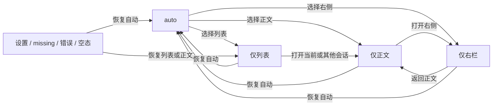

# 全站工具栏与工作区导航：实施入口

2026-10-30。本文汇总本轮只读审计与建议方案，不代表产品代码、线上页面或已批准规范已改变。实施前按项目流程确定设计与验收边界。

- [全站图标、组件及动作盘点](app-action-navigation-audit-20261030.md)：页面路线、图标/aria 索引与跨屏动作归属。
- [工作区状态转换审计](workbench-pane-state-audit-20261030.md)：提交 `5d729bf`，含现状矩阵、源码证据、风险和原始 51 项定向检查结果。
- [真实响应式浏览器报告](workbench-responsive-browser-audit-20261030.md)：提交 `da4587f`，7 个宽度的实际 DOM 状态、截图和未测边界。
- [既有上线与验收记录](workbench-mobile-rollout-20261030.md)：历史版本、真实设备和未测项；不是本轮重设计验收。

## 浏览器实测摘要

在高度 844 下，390、639、640、768、1024、1025、1440 七种 CSS 宽度共检查 28 个基础状态和 49 个模式状态，共 77 个实际 DOM 状态；7 个空右栏状态的仅右栏选项均禁用。另在 320×844、1920×1080、844×390 只检查根页面溢出。

确认四个问题：设置页收起列表后缺恢复入口；仅列表模式点击当前任务仍停在列表；768px 列表 320px 与渠道面板 300px 并存使正文仅约 148px；仅右栏进入子任务后返回变为正文模式。1024px 时外层 Shell 已为 64px 桌面导航而 WorkShell 仍按 tablet 判定是口径差异，不单独认定为故障。物理触控、全部状态交叉和各断点刷新未测；capture 的 364 次操作记录已丢弃，证据以矩阵和截图为准。

## 设计目标

统一模块 toolbar 的骨架、动作归属与可恢复路径；全局导航、当前模块、当前会话、局部面板和输入动作仍各自负责自己的范围。保留已有数据源、设备授权、会话和真实状态；不因视觉统一复制转录或发明新工作流。工作区状态先统一，再做图标和全站视觉复用。

## 跨屏线框

以下是**目标示意**，并非当前页面截图。`L` 工作列表、`C` 当前内容、`R` 右侧工作面板或渠道面板。

### Desktop：最多三列

```text
[全局导航] [左栏开关] 工作 / 当前位置 [设备筛选]       [右栏开关] [布局] [更多]
           会话名 · 真实来源（次级信息）
           ┌─ L 工作列表 ─┬──────── C 会话正文 ────────┬─ R 信息/渠道 ─┐
           │ 搜索 / 新建   │ 转录、当前对象             │ tabs / 卡片  │
           │ 任务与 Bot    │ composer：发送 / 中止       │ 局部动作     │
           └───────────────┴────────────────────────────┴──────────────┘
```

有可显示内容时 auto 可显示 L+C+R；空右栏不占位。手动收起左右栏或选择独显不应丢失返回 auto/正文的入口。窗口原生拖动区/系统按钮另属桌面壳，不把它们混入网页 toolbar。

### Tablet：最多两列

```text
[全局导航] [左栏开关] 工作 / 当前位置 [设备]       [右栏开关] [布局] [更多]
           会话名 · 真实来源
           ┌──────── C 会话正文 ────────┬─ R 信息/渠道 ─┐
           │ 转录与 composer            │ 局部面板      │
           └────────────────────────────┴───────────────┘
```

自动模式中，有可显示右侧内容优先 C+R；确认右侧为空则 L+C。手动选择列表时可让右侧暂时让位，空间让位不改写用户对右栏的持久意图。打开渠道与子会话占 R，不能在 L+C+R 之外再生成第四列；关闭后可回到此前工作右栏或正文。

### Phone：一屏、一个主槽

```text
[头像 或 返回]       标题 / 设备下拉       [主要动作] [更多]
┌─────────────────────────────────────────────┐
│ 当前页：列表、会话或右侧面板                 │
│ composer 仅跟随会话；面板动作留面板          │
└─────────────────────────────────────────────┘
[消息]          [工作]          [市场]          [通讯录]
```

一级页头像与详情返回互斥；设备、布局在标题下拉或更多中，不堆叠三条顶部栏。详情沿既有规则隐藏底栏。auto 在真实右侧内容已知可用时可优先右栏；加载时保留用户选择，异步数据不得抢走正在输入的焦点。关闭右栏回正文，打开列表/正文/右栏均可回 auto。用户触摸、焦点和安全区域必须在实际页面验收。

## 动作归属

| 层级 | 归属动作 | 目标位置 / 不应上移的内容 |
|---|---|---|
| 全局 | 消息、工作、市场、通讯录；个人入口 | 外壳导航和个人入口；不是每个模块重复一套全局按钮 |
| 当前模块 | 模块标题、设备筛选、左右栏切换、布局、模块更多；市场发布 | 模块 toolbar；仅当前模块需要的动作出现 |
| 当前会话 | 会话名、真实来源、渠道与子会话、会话级菜单 | 会话标题/次级信息或模块更多；不冒充全局导航 |
| 列表局部 | 搜索、新建任务、任务/Bot 行及行菜单 | 列表局部条与对应行，不挤进全站顶栏 |
| 面板局部 | tabs、拖动、浮出/停靠、单卡折叠、面板菜单 | 各卡/面板 header；整体右栏开关不能代替单卡停靠 |
| 内容与 composer | 引用、复制、附件、发送、中止；市场卡收藏/点赞 | 当前消息、商品或输入区；保持对象语义和原有权限 |
| 覆盖层 | 关闭 dialog / sheet、返回前一页 | 遮罩/覆盖层局部；关闭、返回与面板收放分别命名 |

## 状态和恢复路线图

1. **意图独立于容量**：以 `(accountId, deviceId, sessionId)` 绑定会话范围的专注意图 `auto / list / content / rail` 与面板选择；断点计算可见列，不把自动让位写成用户关闭。跨设备同号会话不共享草稿、布局、查询或订阅。
2. **auto 的默认右侧优先**：desktop 三列、tablet 两列、phone 一屏；真实右侧有内容时优先可用的右侧，确认空时显示列表或正文。用户主动改变视图后其选择优先，宽度和后续数据不得擅自覆盖；同一已选会话在列表中再次打开也能进入正文。
3. **加载不改意图**：明确 `loading / error / empty / present`；加载或错误不等于空，不能将已选仅右栏永久改成正文。确认空时提供清楚的正文恢复和显式技术信息入口；异步新增内容不能抢夺用户的输入焦点。
4. **渠道是右栏的一种内容**：渠道/子会话与工作信息共享 R 容量、状态及关闭语义，不能绕过列数限制；悬浮卡片在独显右栏时仍可找到并停靠。
5. **没有死路**：设置页、缺失会话、无会话空态、所有卡片浮出和网络错误均保留可见的列表恢复或正文入口。每个操作都能回 `auto` 或 `content`；退出 phone 右侧 sheet 返回其来源并恢复焦点，不靠刷新或重新登录逃生。
6. **断点切换不改手动意图**：在 639/640、1023/1024/1025 等边界及缩放复验 Shell 与 WorkShell 的实际规则；自动排布从意图推导，显式选择不被横竖屏或数据重载抹掉。设备切换先结束旧订阅、隔离结果；离线不等于解绑或删除。



图中为目标可达性；具体 UI 可以使用按钮、标题下拉或菜单，但不得只留一条不显眼的绕路。

## 图标替换建议

用户已明确要求换库：交互 chrome 优先评估 [Tabler Icons](https://github.com/tabler/tabler-icons) 的左栏展开、左栏收起、右栏展开、右栏收起四态官方 SVG，按项目许可保留 MIT 来源；[Phosphor React](https://github.com/phosphor-icons/react) 为备选。先建立动作、方向、状态和尺寸映射，再逐步替换导航/工具栏交互图标，核对按需导入和依赖影响；此文不安装库、不修改产品。自有 Logo、真实用户/Bot 头像和渠道品牌标识保留，不替换成通用图标。返回、关闭、悬浮/停靠各自有明确语义，不用单一侧栏图形代替。

## 实施与验收顺序

- **P0 状态机与逃生入口**：定状态和生命周期契约，合并平板/手机/桌面意图，修设置/missing/浮窗恢复、右侧渠道容量与断点问题；对 loading/error/empty/present 和手动优先写组合测试。
- **P1 顶栏与图标映射**：按四层归属统一工作模块 toolbar；用四态图标实现左右栏动作、名称与状态对应；保持现有权限和键盘操作。
- **P2 全站同层级复用**：消息、通讯录、市场、个人和设置复用骨架与语义；模块/对象/面板局部动作留原上下文，不做视觉统一之外的业务重设计。
- **P3 组合验收**：真实桌面/平板/手机覆盖三断点、四种模式、手动切换、异步加载/错误/空、有渠道/浮窗、settings/missing、键盘/焦点、设备切换与同号 session；同时记录实际截图、网络与用户判断。静态审计、测试、真实浏览器、真实设备及真人触摸分开报告。

本轮静态与浏览器审计已完成，方案实施尚未开始；未修改产品代码或线上。正式实现和验收待后续进行。
