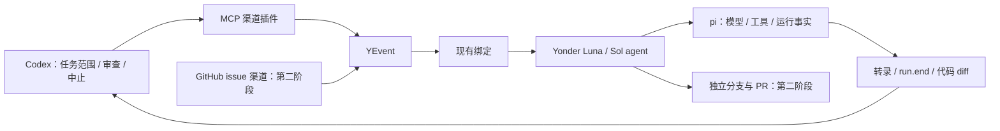

# MCP 控制与项目自维护方案（待审核）

日期：2026-10-18。本文是供用户审核的下一阶段方案，不是已实施的功能，也不替代冻结规范。

## 目标与顺序

保留现有 CLI，把 **MCP 作为第一个新增外部渠道**。先由 Codex 通过 MCP 驱动 Yonder 内部的真实 Luna agent 审查、修复一个明确问题，再逐步处理第一轮问题。第二阶段换用经实际接入验证的 GPT-6.1 Sol 编码 agent，补齐验收、开发 GitHub 插件，完成 issue→方案→修改→PR。

第一阶段不等待全部缺陷都修好才使用系统，但不能把已知的恢复/配置问题包装成可靠自维护能力。每次运行的已知限制随任务交付，发现新问题立即写入任务记录。

## 一条主线

MCP 是传输适配层，不拥有另一份运行状态。CLI、MCP、未来 GitHub 入口共享路由、会话、安全、投递实现。断开控制连接不等于取消运行；取消是明确调用。

## 对三个项目的初步核对

以下是实际读到的模块事实与可借鉴原则，**不是“完整读完三套项目所有源码”的声明**。每项核心维修开始前，再完整阅读与该缺陷有关的入口、状态写入、执行、完成/中止/恢复及测试链；先查证相关共性，再选适合 Yonder 的实现。

### OpenClaw

- 本地快照 `7924f12c75f5e5208a52432583000ed772616b22`。已读 agent-loop 架构资料及 agent/agent.wait、sessions.send/steer 相关入口。
- 接收任务与等待终态分开；外部投递回执与运行结束分开；会话有明确执行所有者，send/steer 归同一入口处理。
- 对 Yonder 的启示：MCP 应返回可追踪的原生事件/会话身份；结束记录不能靠连接是否还在。Yonder 已选 pi，不照搬 OpenClaw 的队列、writer claim、补答与超时体系。
- 依据：[运行主线](https://github.com/openclaw/openclaw/blob/7924f12c75f5e5208a52432583000ed772616b22/docs/concepts/agent-loop.md)、[会话输入入口](https://github.com/openclaw/openclaw/blob/7924f12c75f5e5208a52432583000ed772616b22/src/gateway/server-methods/sessions-messaging.ts)。

### Hermes Agent

- 本地快照 `6e7b83a2f1c093e992a8d838ed77ea320fbd8e51`。已核对架构、模型循环文档及 session.create、session lifecycle 的相关源码。
- CLI/gateway/ACP 使用同一核心运行能力；入口负责平台差异；迭代预算位于模型循环边界，取消与终结是独立行为。
- session.create 使用调用方的稳定幂等键，但这份实现是带 TTL 的内存映射，不能据此宣称它提供崩溃后 exactly-once。
- 对 Yonder 的启示：不在 MCP/GitHub 各复制一套 agent，不在每个工具上打补丁凑轮数上限；也不复制 Hermes 大量兼容、回退与定时清理机制。
- 依据：[架构](https://github.com/NousResearch/hermes-agent/blob/6e7b83a2f1c093e992a8d838ed77ea320fbd8e51/website/docs/developer-guide/architecture.md)、[模型循环](https://github.com/NousResearch/hermes-agent/blob/6e7b83a2f1c093e992a8d838ed77ea320fbd8e51/website/docs/developer-guide/agent-loop.md)、[会话入口](https://github.com/NousResearch/hermes-agent/blob/6e7b83a2f1c093e992a8d838ed77ea320fbd8e51/tui_gateway/methods_session.py)。

### OpenCode

- 官方源码临时克隆 `60a5a6ca7ce176b04cd2321ffd1819b1ea8e6006`。完整阅读 execution 与 restart 模块，核对 session.prompt handler 与 Session Core 约束。
- 持久输入接纳与执行唤醒分开；执行开始/终结与数据库 claim 一起提交；恢复从未释放的 claim 推导，用户中止和进程关闭区别处理。
- 源码明确恢复为 at-least-once，不声称进程内协调能防止崩溃后的外部副作用重复。
- 对 Yonder 的启示：恢复必须有持久依据，不能依赖 shutdown 一定执行；我们优先复用 pi 已有任务记录，不再实现一份 OpenCode 的协调器。
- 依据：[执行所有权](https://github.com/anomalyco/opencode/blob/60a5a6ca7ce176b04cd2321ffd1819b1ea8e6006/packages/core/src/session/execution.ts)、[重启恢复](https://github.com/anomalyco/opencode/blob/60a5a6ca7ce176b04cd2321ffd1819b1ea8e6006/packages/core/src/session/execution/restart.ts)。

### 可以采纳的共性

入口薄、运行核心共享；接收、执行终态和交付分开；一个明确的会话执行所有者；取消走显式路径。持久化和恢复实现细节并不一致，不能虚构“三方都用了同一个方案”。最终方案仍以 Yonder 的 pi 所有权与当前需求为准。

## 第一阶段：MCP 与 Luna 受控自修复

### M0｜先冻结本轮契约

- 依据：04 §8 已规定“外部 MCP→channels + io.ask；会话管理映射 api.sessions”，但 architecture §6 将 MCP 实现排除在 0.1 之外。
- 设计方需修改：`docs/architecture.md`、`docs/spec/04-plugins.md`、必要的 `01/02/05/06/07/08/09` 小节、`docs/decisions.md`、`docs/index.md` 与任务索引。只改本轮采纳的条款，不扩写完整下一代架构。
- 本次先确定 MCP 管理权限、输入与结果语义；M1–M3 的受控单次运行明确不承诺崩溃续跑。进入 M4 前再决定审查报告 D1 恢复/交付承诺、D2 配置取值时间、D3 终止点；GitHub 准入规则在阶段二另有明文。
- 预期：每项任务可追溯到文档、可修改路径和验收；实现者不会临场补公共语义。

### M1｜新增 `channel-mcp` 插件

**拟新增路径**：`plugins/channel-mcp/package.json`、`tsconfig.json`、`src/index.ts`、必要的 `src/server.ts` 与插件测试；根 package.json/package-lock/tsconfig 加 workspace。现有核心能满足的部分直接用 SDK，缺口另归原 T 任务，不让插件 import core/pi。

**建议传输**：插件随 harness 常驻，在回环地址提供标准 Streamable HTTP。优先官方 MCP SDK 与 Node HTTP；实际安装时核对 SDK 稳定版本和所需依赖。只做一个传输，暂不同时做 stdio 代理、SSE 旧协议、远程托管与 OAuth 服务。

原因：当前插件生命周期在已启动的 harness 内，直接映射 PluginAPI 最短；stdio 若另启 harness 会争抢 home，若转发又增加一层控制协议。回环 HTTP 需要鉴权、Origin/Host 边界检查，这是该实际入口的必要条件，按官方 SDK/协议处理，不自己写认证框架。凭据引用走现有 credentials；不把 token 放进工具结果或源码。[MCP 传输规范](https://modelcontextprotocol.io/specification/2025-11-25/basic/transports)

**工具覆盖，按现有业务 API 显式映射：**

- 发给 agent：`yonder_message` 构造本渠道 message.in，调用 io.emit；`yonder_ask` 走 io.ask 并返回现有 AskResult。来源由已认证渠道确定，外部不能冒充内核 agent 渠道使用 target。通过预设的 conv→绑定选择 agent。
- 事件：查询及插件自定义事件提交；不能伪造 run.end/message.out 等内核事实。
- 会话：list/get/open/submit/abort/close/transcript。open/submit 仍仅驱动预设；常驻 agent 必须走绑定。
- 身份：account/person/relation/lookup/createPerson/link/unlink，复用现有接口；管理工具仅面向此本机受信任控制端。
- 消息：messages.send，复用原生发送和记录；模型/服务只暴露无秘密的描述和可用性。credentials.get、携带密钥的 resolve 结果、models.login 不直接映射成模型工具。
- 配置与 agent 创建目前不是 PluginAPI 的 CRUD：首次 agent 由现有 init/YAML 方式配置。**不为“所有接口”增造一套配置数据库或反射式任意方法调用器。** 若确需 MCP 创建 agent，在文档审核时单列真实缺口。

异步提交返回现有 YEvent/routes，外层按会话转录和 run.end 查询进展；无需先造任务中心。同步 ask 的取消只取消等待，不暗中中止一个可能含其他输入的共享运行；显式 abort 才中止。请求结果不明时先查询，不盲目重发产生第二个任务；稳定请求身份与恢复若有接口缺口，按 D1 一次解决。

第一版输出可通过 ask 返回，异步结果从现有事件/转录读取；不谎称无订阅客户端时主动推送已送达。只有实际需要 MCP 流式推送时才接官方通知机制。

**验收**：真实 MCP 客户端列工具→提交→查事件/转录→取结果→中止一次运行；非法来源/管理入口的必要边界检查。模型用真实 Luna，不用假模型证明闭环。

### M2｜创建真实 Luna 审查 agent

- 运行配置放隔离开发 home，例如 `.yonder/self-review/`（拟建、已在忽略目录内）；源代码工作区指向本项目的独立受控工作树。凭据只引用本项目获准的模型凭据。
- Agent 名建议 `maintainer`，配置档区分 audit 与 repair；首次 audit 只授予 read，使用 `openai/gpt-6-luna`。修复时按具体任务授予 read/write/exec；工作目录不是安全沙箱，不作虚假隔离承诺。
- SYSTEM/AGENTS 写入用户原话中的核心约束：先理解调用链与失败路径；根因在共享层修；只改任务路径；不新增假想功能；发现设计空白报告；不削弱检查；明确代码、构建、测试与真实运行的证据区别。
- Codex 下发一项已有问题，要求模型独立确认依据和调用链。保存 event/session/run、真实模型名、工具记录、问题报告。模型说“完成”不是验收，Codex 核对实际转录和 diff。
- 预期：我们第一次通过外部协议使用自己的系统完成真实项目审查，明确看到成功或失败在哪一层。

### M3｜让 Luna 完成一个局部修复

- 先选报告 R5 的明确局部项之一，例如 task_run 的错误状态/原因丢失；不把整仓所有问题一次交给 Luna。
- Codex 先完成对应三项目相关调用链的比较，写清为什么选择本方案；不按项目数量投票，不照搬框架。
- 给 Luna 一份任务：已批准行为、允许路径、复现证据、最小验收、禁止改的契约。它读代码、改代码、运行对应检查、提交结果；Codex 亲自检查越界、删改断言和实际行为。
- 发现运行系统自身问题立即追加任务问题，保留失败证据；只有当问题妨碍继续且语义明确时修共享根因，设计分歧进入讨论。
- 同时只允许一个 agent 修改本仓库。无需新增调度器、修复 agent 集群或自动评委系统。
- 接受的变更一个任务一个提交；在独立工作树验证新构建，再由 Codex 切换开发实例。正在执行的 agent 不直接覆盖其运行中的安装。

### M4｜修复主链，再扩大自修复范围

- 按审查报告 R1–R3 处理运行事实、配置固定、完成收尾；涉及 `runtime/`、`routing/`、`sessions/`、`delivery/`、`kernel/`，仅按批准的任务拆分修改。
- 再处理配置引用校验、附件与预设、steer 权限、模板与版本通知。
- 一次完整演练：提交→工具运行→中途停止/重启→继续或明确失败→结果可查；避免重复外部副作用。通过后才能把它称为可恢复的自维护循环。
- 已有 build/typecheck 与原定验收保留；按问题补必要检查，不展开无限回归循环。

## 第二阶段：Sol 测试与 GitHub 自维护

### G1｜由 Yonder 的 Sol agent 补验收

- 使用用户指定 GPT-6.1 Sol；先确认当前 provider 可用的实际 model ID，不能把 Codex UI 名称直接当作模型 API 已支持的证据。Luna 不自动替代已指定的阶段二模型。
- 依据现有 T02–T14 验收和 T12 设计、实现、执行测试；记录原始通过/失败/跳过数，先复现再修复。仍不改冻结设计，不使用模拟模型伪装模型能力。

### G2｜开发 GitHub 插件并由用户登录

- 拟新增 `plugins/channel-github/`，一个插件同时提供 issue 渠道与必要 GitHub 工具；不新增“GitHub 微服务”。
- 本机已有 gh。建议第一版复用 gh 的浏览器授权与系统凭据存储，插件调用受信任 gh API 命令，不导出 token。授权时自动打开浏览器，由用户确认；若 gh 无安全存储，不静默落明文。[gh auth login](https://cli.github.com/manual/gh_auth_login)
- 这条路径授权页标识为 GitHub CLI；若要求页面显示 Yonder Harness，则需注册自己的 GitHub App，另定权限和回调。两者不能混称。当前不创建 App、不申请额外权限。
- 只接项目仓库，首版轮询已授权 issue/评论，用原生消息 id 与持久游标防止同一输入重复接收。消费成功后再推进游标；细节依 D1 的接收契约。暂不建立公网 webhook、隧道或队列服务。[GitHub issue API](https://docs.github.com/en/rest/issues/issues#list-repository-issues)
- 事件使用 `acct:<实例>:<GitHub 用户 id>`、`conv:<实例>:<仓库+issue>`、kind=issue；按 issue 建 persistent 会话，通过既有 binding 路由到编码 agent。
- 仅接纳配置授权账号发出的维修任务；issue/评论正文是待分析的数据，不是修改授权规则、读密钥或部署的指令。自己的状态评论不再次唤醒自己；PR 记录不当普通 issue 再投递。
- 工具覆盖读取 issue/评论、更新进度、创建 PR 与查询检查。分支和提交复用 git。首次完整链路只操作专用任务分支，PR 交用户审核，不自动合并、发布或覆盖安装。

### G3｜真实 issue → PR 演练

1. Codex 把已经审查清楚的问题提交到本项目 issue，包含触发条件、规范、允许路径与验收，不只写“帮我修 bug”。
2. GitHub 插件将该 issue 转成事件，编码 agent 经绑定接收。
3. Agent 读规范与源码、产出根因方案；规约内明确实现问题由 Codex 按用户已批边界审查，改变设计/公共契约的方案仍交用户。
4. Agent 在专用分支实现、测试、提交并创建 PR，回报真实检查结果；Codex 审查 diff，用户审核 PR。
5. 用实际 issue URL、输入事件、会话、commit、PR URL 证明闭环。缺其中哪一环就报告哪一环，不以模型口头完成替代。

## 本次放行点

建议审核并放行 **M0–M3**：文档修订、MCP 插件、真实 Luna 审查、一个受控局部修复。M4 的主链设计按本次审查 D1–D3 另逐项确认；G1–G3 保留为第二阶段，不提前申请 GitHub 授权或发 issue。

需要这次审核，是因为项目 AGENTS 第 7 条要求“改设计由设计方进行：先改 docs，在 decisions 记一条”，且 architecture §6 当前明确排除 MCP 实现。两个最小化 skill 没有要求额外审批；这里的审核来自用户先审方案的要求和冻结设计边界。
