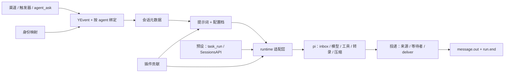

# 第一轮源码审查与边界评估

日期：2026-10-18。基线：`9340c47`，分支：`zoran/first-pass`。主 agent 亲自审查，未把本次审查委派给子 agent。

## 结论

**默认 Luna 的单次对话与工具调用已跑通，但尚不能把系统交接为可靠的常驻、自修复系统。** 最重要的缺口集中在运行恢复、运行中配置一致性和投递收尾；不是缺少更多插件槽或通用框架。

现有分层可以保留。应让 pi 继续拥有会话和运行事实，Yonder 只补齐事件关联、运行所用配置和交付结果。不要用更多内存标志、重试、超时包装或第二套任务队列补洞。

本次已修复明确、局部且不改变规范的实现问题。跨模块主链问题记录在下文，尚未修复；涉及公共语义的事项另列为设计问题。冻结的 spec、architecture、decisions、index 和 AGENTS 未修改。

## 审查范围与证据

- 逐项对照 architecture、decisions、spec 01–09 和 T00–T14，阅读 SDK、core、CLI、两个插件的生产源码与现有测试；当前共有 47 个源码/测试 TypeScript 文件。
- 跟踪了入站、绑定、会话、提示词、pi 提交、工具、流式、投递、配置重载、停止及离线查询的调用链。
- 核对锁定版本 pi 1.3.0 的 scheduler、tool、Harness 行为；不能仅凭适配层方法名推断恢复已经实现。
- CodeGraph 未初始化，因此使用实时源码导航，未生成过时或虚构的调用图。
- 下文“源码确认”指有具体可达调用路径；“实测”另行标明。并发、崩溃组合没有实测的，不声称已复现。
- 使用 [Ponytail](../../../../.codex/plugins/cache/ponytail/ponytail/4.10.0/skills/ponytail/SKILL.md) 与 [Stop That Shit](../../../../.codex/plugins/cache/stop-that-shit/stop-that-shit/0.2.4/skills/stop-that-shit/SKILL.md) 的根因、最小范围原则。此处不以行数少代替行为完整。

## 当前架构



### 目录职责

```text
packages/sdk/src/        插件公开类型、引用、清单与契约检查
packages/core/src/
  config/               YAML、配置档、重载
  store/                y_events / y_sessions / y_accounts / y_persons
  runtime/              唯一 pi 运行时入口；模型、凭据、环境、转录、钩子
  plugins/              加载、注册、实例、生命周期
  routing/              绑定与事件驱动
  sessions/             四类会话、预设调用
  prompt/               system / turn、附件、版本通知
  delivery/             自动回复、流式、主动发送
  tools/                内核工具和 skill_view
  skills/               发现、优先级、索引、文件读取
  kernel/               装配、启动、停止、初始化
  control/              本地控制 socket
  release/              安装、更新、版本与 launchd
packages/cli/src/       yonder 命令
plugins/channel-cli/    CLI 渠道
plugins/context-files/  工作区 Markdown 上下文
docs/spec/             冻结的行为契约
docs/tasks/            实现记录、问题与验收
```

### 关键决策与实际边界

- 一个 SQLite 文件、一条连接；pi 管 `pi_` 状态，Yonder 管四张 `y_` 表。事件只追加，模型转录不再复制一份。
- 常驻 agent 只能经绑定唤醒；预设由显式调用创建。`main/persistent/ephemeral/task` 是会话用途，不是四套模型循环。
- 插件有八个槽：channels、tools、contexts、triggers、envs、hooks、presets、skills。安装提供者与配置实例分开；安装不自动赋予 agent 工具。
- 能力与级别在工具暴露和调用前执行。`exec` 是本机执行能力，不是路径沙箱；不能靠“工作目录在仓库里”宣称文件系统已隔离。
- SDK 仍以类型方式暴露部分 pi 类型；运行时 import 边界符合约束。不要把这种隔离描述为完全不受上游类型变化影响。
- skill 按工作区、home、插件顺序取同名优先项；system 放索引，`skill_view` 读取选中的文件。真实路径限制是需要保留的输入边界。
- 安装版本目录与 current 链接、固定 Node/PATH wrapper、launchd 已有实现；不是已经安装、发布或经升级验收。

### 已实现插件与工具

- **`@yonder/plugin-channel-cli` / `channel-cli`**：注册 `cli` 渠道；每实例一个本地私聊会话、一个连接；Unix socket 输入，文字/工具过程/最终结果输出。不支持附件输出。
- **`@yonder/plugin-context-files` / `context-files`**：`agents-md`、`user-md`、`soul-md`、`memory-md` 分别读取 AGENTS.md、USER.md、SOUL.md、MEMORY.md。只对被选中的贡献创建模板、拼入 system；它不是记忆检索引擎。
- **pi 工具**：read、write、edit、bash、tool_search。
- **Yonder 工具**：message_send、agent_ask、task_run、session_list、session_read、identity_lookup、identity_link、skill_view。
- **尚无实现**：MCP、GitHub、飞书、QQ、记忆引擎、远程执行环境、审批、工作流。用户追加的 MCP 与 GitHub 自维护属于下一阶段方案，不能列成现成功能。

## 已修复的实现问题

### F1｜CLI 离线、输出与断开

- `control/index.ts`：readline 没有错误监听，socket ENOENT 变成未处理错误，查询无法回退离线。现在正常 reject；缺 socket 定向检查通过。
- `cli/src/index.ts`：`--json` 回显混入 stdout、final 与过程文字不同却被吞、服务端断开后仍等输入。已修复；真实临时 socket 驱动实际 CLI 子进程验证 JSONL 与退出。
- 同时拒绝 `--home` 后跟另一个选项、chat 多余位置参数。没有重写参数解析框架。

### F2｜身份与独占

- `kernel/index.ts`：每次启动按初始配置重建身份会恢复已经解除的关联、覆盖人的改名。现在只初始化尚不存在的人和账号；解绑、改名、重启检查通过。
- home 锁失效原来只记日志，进程仍可能继续写同一数据库。删除自定义吞错回调，恢复 proper-lockfile 的失败行为；未模拟真实锁被夺取。
- 未指定 channel 的 kind 校验原来把内部 agent 渠道也当作必须支持 dm。改为检查所选渠道的 kind 并集；启动检查覆盖。

### F3｜CLI 插件生命周期

- 移除模块全局 PluginAPI，按加载实例捕获 API，避免同进程多 home 互相覆盖。
- 已持 home 锁时清理崩溃遗留 socket；真实子进程 SIGKILL 遗留 socket 后启动检查通过。
- 第二客户端写完错误再关闭；处理断开读取错误；一次 stream 固定接收连接，重连不会接走旧连接的后半段输出。后两项未做所有组合实测。

### F4｜插件加载与事件边界

- 用 Node `findPackageJSON` 代替不可靠的父路径解析与向上找包循环；只在明确“包不存在”时回退安装依赖，其他错误保留。
- 观察器原来只能保证单次 observe 内顺序，并发事件会乱序。现在每插件一条观察链，单处理器失败不阻断后续；传副本，避免观察器改动路由中的同一对象。
- 检查自定义事件命名空间、内核保留事件、渠道来源归属及普通渠道禁止使用 target。符合 01 §3 与 02 §2，属于实际信任边界，不是额外沙箱。
- 本地 import-only 插件、顺序、异常隔离、不可修改原事件及伪造内核事件拒绝均有最小检查。

### F5｜触发器路由

- `routing/index.ts`：`plugin:` 来源不再作为账号查身份；账号关系 match 不适用于非账号来源。已有触发器路由检查覆盖。

### F6｜凭据路径与真实流式

- runtime、login、kernel 统一解析配置中的 `~/` 凭据路径，与 08 的示例一致。
- pi 可能在 submit 返回前发出 run_start；原监听丢掉起始归属，整次工具流式不出现。先建监听，在提交关联就绪后处理已收到的事件。
- pi 输出也可能用完整消息/内容块，而非只有 text_delta；转换现在同时处理二者并避免重复前缀。
- 真实 Luna 调用 bash：首次缺 tool 失败，修复后缺 text 再失败，补全消息块转换后通过。保留这两次失败，不把最终通过写成从未失败。

### F7｜测试入口

- 根 test 原来同时发现 src 与编译后的 dist 测试，导致重复、可能运行旧产物。现在排除 dist，并移除不再需要的 passWithNoTests。

## 尚未修复：按领域列出

P1：阻碍常驻/自修复闭环或影响状态、权限事实；P2：局部契约缺口。严重度是本次评估，不代表所有路径均已动态复现。

### A. 运行、事件与恢复

**R1｜P1｜实现缺口：持久化已接入，恢复闭环未接通。**

- 依据：02 §1、07 §1–3、架构不变量 4。位置：`runtime/index.ts:128`、`routing/index.ts:169`。
- pi 的 scheduler.open 明确只恢复记录、不调度；Yonder 启动没有 resume。不能仅凭 Harness.open 判定自动续跑。
- 事件入库后异步 dispatch；两者之间退出会留下未提交输入。一般输入没有由事件派生的稳定 requestId。
- submission→event、run 来源、完成回调只在内存。只补一个 resume 会让模型继续，却无法可靠恢复来源权限、run.end 和投递。
- 最小方向：先从现有 pi submission/entry 与事件恢复关联、接上结束处理，再启动调度；用事件与目标会话确定提交身份。不新建模型队列或转录库。跨存储步骤的确切恢复契约见 D1。

**R2｜P1｜实现缺口：运行中的配置不是同一份。**

- 依据：08 §3“下一次运行生效”、05 §4。位置：`runtime/index.ts:152,205,222,244,417,500`，`delivery/index.ts:92,306`。
- 模型/tools 经 configure 设置；安全钩子、环境、提示词仍即时读取热重载配置。新输入提交也会 configure；结束投递又读当前绑定和模型。
- 可能一轮中模型、工具权限、env、reply 策略来自不同版本；run.end.model 还可能记录新模型而不是实际使用的模型。
- 最小方向：实际运行开始时确定一份配置，所有运行内消费者使用它；在排队、恢复、删除配置档时的版本选择另定 D2。不要在每个模块分别加锁或缓存。

**R3｜P1｜实现缺口：多处“已完成”状态既不持久，也不释放。**

- 位置：`runtime/index.ts:114–116`、`routing/index.ts:64`、`delivery/index.ts:89,226`。
- states/submissions、handledRuns/completed 持续保留终结运行；重复完成控制分散。delivery 在 IO 和 run.end 落库前就加入 completed；后续失败被报告后，此进程也不能正常再完成收尾。
- 最小方向：与 R1 一起统一结束处理，持久结果决定已完成，内存仅放活跃观察者并及时释放。不加 TTL/LRU 去掩盖生命周期缺口。

### B. 配置、会话与预设

**R4｜P1｜实现缺口：热重载没有完成引用校验。**

- 依据：08 §3、架构不变量 9。位置：`config/reload.ts:54–60`，对照 `kernel/index.ts` 的启动配置校验。
- parseAgentConfig 成功就替换 agents；不存在的模型、插件上下文等引用没有复用启动校验，会报 reload 成功，下一次运行才失败。
- watcher 建立初始 seen 时重新读文件，与启动所用内容并非同一次；该窗口的修改可能被当作已经应用。预设读取失败分支也会漏回填 homePresetIds，影响之后删除处理。
- 最小方向：共享候选配置校验，再一次性发布；seen 从实际接受的版本开始。已使用配置档的删除策略见 D2。

**R5｜P1/P2｜实现缺口：预设入口与普通运行转换不一致。**

- 依据：01 §1、02 §5、03 §4。位置：`sessions/index.ts:90–106,140–147`，`runtime/index.ts:688–739`。
- session.input.parent 写成父会话 id，而字段要求上游事件 id；会破坏因果链。
- SessionsAPI.submit 的 attachments 不进入准备输入的事件，prepareInput 返回的空数组又覆盖原附件，图片和附件提示会丢失。
- 父 agent 会话的 SessionDoc.env 可能还是创建时工作区环境，优先于父配置档实际 env，导致预设继承错误。
- runtime.runTask 把所有 unanswered 都变成 aborted，并丢掉非上限错误原因；与普通 submit 的结果解释不同。
- 最小方向：共享输入/结果转换、使用父运行的实际环境；保留 pi task-owned 子会话语义。不要机械合并两条入口而丢失子任务归属。

### C. 投递、并发来源与权限

**R6｜P1｜实现缺口：输入级流与运行级结果归属没有完全对齐。**

- 依据：02 §1.2、06 §2–3。位置：`routing/index.ts:107`、`delivery/index.ts:190–227,261`。
- onStart 在实际 runId 尚未确定时按 session/input 占流槽。下一轮在上一轮异步收尾释放之前开始时，部分输出会被 current !== key 丢掉。
- steer 会把多个输入并入一轮，但监听/等待者来自各次提交；出现等待者之前已经发出的流式文字也无法撤回。完整组合未实测，等待者与流式优先级见 D4。
- 最小方向：流式归属跟着 pi 的实际 run 与 inputs，不按“某个 Promise 大概还没结束”推断。

**R7｜P1｜实现缺口：steer 的后续来源与附件没有进入完整授权集合。**

- 依据：05 §3、06 §2/5。位置：`runtime/index.ts:152–165`、`runtime/index.ts` 的 contextForAttachment、`delivery/index.ts:339`。
- ToolContext.event 只选第一个输入。后续并入输入的来源被当成外部发送目标；新附件也可能不在读取豁免范围。
- 最小方向：内部按实际 run.inputs 计算来源和附件集合；无需把 SDK 的单 event 字段强改成所有调用者都得适配的新接口。

### D. 提示词、附件、skill

**R8｜P1/P2｜实现缺口：图片限制与附件持久关联不完整。**

- 依据：03 §5.3。位置：`prompt/index.ts:101–111,142–169`。
- 未提供 bytes 的本地图片按 0 计算；未核实图片尺寸；maxPerRequest 只看本次输入，未计已有上下文图片。超出 inputLimits 仍可能被提交。
- 下载后的 URI 只进入内存中的 preparedEvent；持久原事件仍是远程 URI，重启不能依赖该内存关系。
- 最小方向：在唯一附件准备入口取得实际必要元信息；与 pi 组装真实请求的边界配合检查。下载取消和总时间范围属于 D3，不到处重复加校验。

**R9｜P2｜实现缺口：版本通知过早确认、上下文模板未随选择更新。**

- 依据：03 §5、04 上下文文件规则、09 §4。位置：`prompt/index.ts:161–174`；`kernel/index.ts` 的 scaffoldWorkspace 调用。
- notice 在后续 contributions/submit 成功前更新 version；失败后再试会漏通知。预设路径更在 prepare 前更新版本。
- scaffold 只在启动时执行；热重载新选中一个需要模板的 context 后，没有对应创建步骤。
- 最小方向：在输入实际提交的完成点确认版本；候选配置发布时完成其所需模板，不加后台补偿扫描。

**R10｜P2｜实现问题：skill 来源标识与不必要遍历。**

- 插件 skillDirs 丢失插件 id，来源显示为 `plugin:<目录>`，不能准确对应插件清单；注册时保留 id 即可。
- `tools/index.ts:113–119` 的 task_run 每次翻查全部 session.input 分页以找子任务事件，是恢复关联缺位造成的多余扫描。应从已有任务/事件关联取得，不增加全文缓存。
- skill 逐轮发现由规范要求，本次没有性能证据支持增加缓存。SDK 与 core 的部分前言校验重复属低优先维护债，暂不为代码整齐单独重构。

### E. SDK、存储、安全与发行

- **SDK / 存储**：已核对类型、引用、注册槽、四张表、查询、身份和 pi 共享连接。除上述身份初始化、session.input 因果等调用方问题，本次未确认新的阻断性存储实现缺陷；不等于迁移、并发与所有异常路径已验收。
- **安全**：保留能力过滤、调用前判定、受保护文件、skill realpath 边界和凭据锁。不是要清除这些必要检查。`maxTurns` 缺口涉及规范指定的钩子方法，单列 D3，不能归咎为实现者没有照文档做。
- **CLI / 品牌**：可控产品展示是 Yonder Harness；OAuth 服务端最终名称未重新登录确认。Windows 命名管道未实现，0.1 平台范围需明确；macOS 长 socket 路径限制已有失败记录。
- **发行 P1 验证缺口**：安装、更新、回滚、版本保留与 launchd 代码已读，但没有真实完整周期证据。现有 release 检查只覆盖解析、文档、wrapper/plist 语法。当前 Node 24.21.0，不代表声明下限 Node 22.19 已运行通过。见 T14；不是据此断言安装一定有 bug。
- **停机边界**：control 的长连接或插件 stop 不返回可拖住退出；这与 D3 的生命周期取消契约同属设计边界，不应擅加统一几秒强杀。

## 设计问题：先定语义，再改代码

### D1｜恢复与投递到底承诺什么（优先）

三件事必须分开：**输入已接收、运行已结束、消息已送达**。现在事件和 pi 之间的恢复关联没有完整说明；外部发送成功到 message.out 落库之间还存在不可消除的进程崩溃窗口。

建议：pi 管运行；现有事件记录接收与结果，明确关联；对“外部可能已送达但本机无确认”的结果显示未知，不自动重发。需要保证自动重发时，再要求具体渠道支持幂等键。不能无依据承诺 exactly-once，也不为此先造通用 outbox 平台。

### D2｜运行配置与删除语义（优先）

“下一次运行生效”已有要求，但排队输入按接收时还是实际开始时选配置、重启恢复用哪个版本、删除仍被会话使用的 profile/preset 时怎么办，没有完整定义。预设已保存的有效能力与新预设配置混用也需明确。

建议：实际开始时固定配置；恢复沿用该运行的配置；下一轮使用新配置。仍被引用的定义不静默替换或改名迁移，候选更新应明确报错或先关闭会话。具体快照数据放在 pi 已有扩展文档/提交边界，避免第二套会话表。

### D3｜有限运行的终止点（优先）

07 §5 指定 afterResponse 计数、afterTool 终止，但 pi 1.3.0 的无效/被阻止工具不执行 afterTool。因此即使照规定实现，连续被拒绝的模型轮次也可能越过 maxTurns。重复第 5 次同样按规定先执行再 terminate，会再次产生副作用。这是**目标与规定手段不相容**，需要修订设计后实现。

此外计时从请求钩子开始，附件下载和 context.render 在外，Channel.send/stream、插件 stop 没有取消参数。建议在模型轮边界限制下一轮、重复副作用发生前停止；明确定义运行计时覆盖范围，把取消信号接到真实外部 IO。单进程可信插件不可能靠普通 Promise 超时获得强制终止保证。不要为每个函数加重试或超时包装。

### D4｜多输入、等待者与错误回复

06 规定有等待者时返回调用方，同时又规定错误/上限向来源说明；混合 steer、后到等待者和已经开始的 stream 没有完整优先级。应明确一轮是否允许混合、哪些内容可已流出以及错误交给谁。不要用每个输入一组 suppress 标志继续堆补丁。

### D5｜事件信息如何完整传给模型

- session.input 要记录调用方 agent/plugin，但 SessionsAPI.submit 没有调用方字段。可以由内核绑定插件/工具调用身份，不要求插件自己伪造 from；因果事件和父会话必须区分。
- 自定义触发事件 data 没有通用文字约定，prepareInput 却按 message.in 读 text；非文字 payload 可能不会进入模型。需要一个明确的最小呈现约定，不是任意字段模板引擎。
- `<turn>` 中来自外部的名称/附件名可含换行和标记，当前会破坏框架行结构。应把外部内容表达为数据，不能把简单转义声称为解决全部 prompt injection。

### D6｜插件扩展承诺的实际范围

- EnvProvider 每实例 create，未清楚定义多工作区 cwd 与远程附件搬运。0.1 不实现远程，但“接口已能支持远程”尚无证据；写第一个远程插件前定约定即可，现在不造远程平台。
- 提供者 config 是否剥离 type、第二 CLI 客户端错误形状、Windows 支持范围：小而明确的文档决策，沿用现状最小化，不另加配置开关。
- 新 MCP 必须作为现有业务接口的适配入口，不让外部 agent 绕过绑定直接驱动 agent 会话；不把 credentials.get 或带密钥的服务解析结果直接暴露成模型工具。详见下一阶段方案。

## 过度设计与过度防御自查

**没有发现需要推翻的通用框架堆积；严重问题是“运行事实被分散管理”。** 小补丁可能很短，但会继续增加同步负担。

- 应收拢：Runtime/runTask 重复结果解释、多处 completed 标志、按输入预占 session 流槽、全事件扫描找任务。这些围绕同一生命周期根因处理。
- 已删减：插件包解析的广泛吞错/遍历回退；失锁只记日志继续运行；CLI 插件全局 API。
- 应保留：凭据锁与权限、边界 schema、来源归属、真实路径约束、两处工具安全判定。这些对应明确要求或实际输入，不是防御性杂物。
- 暂不做：DI 框架、统一 retry 平台、事件总线替换、队列再造、全仓格式清理、为可能出现的远程/多租户环境加抽象。
- 评价最小方案应看“新增状态与规则是否更少、所有入口能否复用同一事实”，而不只看某一段 diff 的行数。

## 实际验证与原始结果

- build、typecheck：通过。
- 修复后的 `npm test`：15 文件通过、1 文件跳过；**17 测试通过、1 跳过**。跳过的是需显式启用的真实模型检查，该检查另行真实运行通过。
- 真实 Luna 流式检查：第 1 次 1 失败（无工具过程）；第 2 次 1 失败（无文字增量）；第 3 次 **1 通过**。不是多渠道、恢复或全部工具的验收。
- 定向检查：T11 3 文件/4 测试通过；T10 1/1；T06/T07 2/3。这些与完整轻量测试有重叠，不累加为独立覆盖。
- 修正测试入口前的全量发现：28 文件通过/2 跳过，32 测试通过/2 跳过；含 src/dist 重复，**不作为独立覆盖数**。
- 全仓 lint：首次 33 errors、13 warnings、1 info；仅整理本次已触碰且原本已格式化的文件后，**仍有 26 errors、13 warnings**。主要为已有及本次触碰的未统一格式/导入顺序，还有非空断言等警告；没有声称全绿，也没有顺手格式化全仓。
- 尚未执行：T12 原定完整验收、真实进程崩溃续跑、多渠道 steer/followup、真实安装升级服务周期、新 home OAuth、飞书/GitHub/MCP、Node 最低版本验证。

## 下一步顺序

1. 审核 D1–D3 与 MCP 自修复方案，先修正文档；不要在未定语义时继续堆主链补丁。
2. 接通最小 MCP 控制场景，让真实 Luna 审查 agent 先报告一个限定领域的问题；外层 Codex 保留中止、检查源码和接受修改的控制。
3. 按 R1/R2/R3 的共享根因整段修复，补对应最小检查，再处理会话/附件/投递局部问题。
4. 完成真实闭环后进入用户提出的 GPT-6.1 Sol 测试与 GitHub issue→方案→修复→PR 阶段；不自动合并或替换日用安装。
