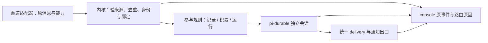

# O49 / X01：渠道与社交分层

状态：设计提案，待维护者评审后由 CH 卡实现；不是现有 SDK、配置或运行能力的声明。仅新增本文与 lead 仓库的 CH 卡，不修改现行 spec、代码或主人 home。

依据：`yonder-lead/program/source/owner-messages.md` O49（10-28 10:26），尤其多渠道分层、渠道失败/重复回复、tasks 打扰三段。背景为 `program/agent-ux/{gap.md,plugins.md,inventory/matrix.md}`；原 A 卡不覆盖 O49。源码观察基点：harness `160745a0066ad49b8db8cda2e5fde56f4bfdaefc`，2026-10-28 并行工作区，未运行主人服务。

## 1. 结论与边界

保留「事件 → 绑定 → durable 会话 → 投递」主线。统一接入事实、参与决策和通知出口，不引入第二套 Agent、会话、模型队列或任务账本。

- 主人与**每个 Bot**的已验证私聊账号进入该 Bot 唯一 main，console 被动汇聚原消息、调用与回复；回复跟着输入来源，不跟着最近打开的客户端。
- 授权用户/授权群由主 Agent 本体参与，但使用独立 persistent 会话及受限 profile，不进入主人 main。特定对象可明确映射到专属常驻 Agent；临时 task 子会话不是渠道身份。
- 身份、参与、工具权限、投递、通知是不同问题：好友不是管理员，@Bot 不是授权，免打扰不是停止记录，模型判断不能扩大权限。
- 默认群聊只记录；已授权群积累消息后才判断是否说话。确定性过滤、计时和汇总不调用模型。便宜模型判断显式启用，输出最多选择忽略/整理/参与。
- 发出、明确未发出、结果未知分别记录；沿用 delivery ledger。未知结果不重发，不承诺跨平台 exactly-once。

## 2. 参考调研与统一方法

以下为 2026-10-28 读取的官方文档/项目材料；仅借鉴列出的机制，未部署这些项目验证。ElizaOS 条目是项目 issue 的历史设计诊断，不当作当前版本实现证明。

| 项目与一手出处 | 观察 | Yonder 采用 / 不照搬 |
|---|---|---|
| [Hermes Messaging Gateway](https://hermes-agent.nousresearch.com/docs/user-guide/messaging) | 单 gateway 连接渠道；准入名单与 admin/user 区分，DM 与群的管理员范围分开；文档明确当前该分层主要约束斜杠命令 | 分开接入与权限；不把已准入人映射为 bypass，不照搬默认中断忙碌 Agent |
| [OpenClaw routing](https://docs.openclaw.ai/channels/channel-routing)、[groups](https://docs.openclaw.ai/channels/groups) | 确定性 binding；main/按 peer 的 DM scope 与群隔离；提及门控与上下文范围分开 | 主人 main、群 per-conv、来源投递；不借 lastRoute 覆盖输入来源，不采用全部 DM 默认共享 main |
| [AstrBot custom rules](https://docs.astrbot.app/en/use/custom-rules.html)、[config](https://docs.astrbot.app/en/dev/astrbot-config.html) | 会话用 UMO 标识；会话规则覆盖 profile 对应设置；有白名单和唤醒前缀 | 精确 conv 标识和可解释覆盖；不按显示名推断身份，不复制整份配置到每个群 |
| [LangBot pipelines](https://langbot.app/docs/en/usage/pipelines/readme/) | Bot 绑定处理 pipeline，同 pipeline 可服务多个 Bot | 适配器与公共处理分离；不引入另一套工作流编排器 |
| [Koishi filter](https://koishi.chat/zh-CN/guide/plugin/filter)、[context](https://koishi.chat/en-US/api/core/context) | platform/self/user/guild/channel 组合过滤；插件可限于子上下文，broadcast 考虑 silent | 用渠道实例+conv+账号定位，组合固定条件；不开放任意用户脚本表达式 |
| [NoneBot Matcher](https://nonebot.dev/docs/api/matcher) | rule、permission、priority、block 分别表达匹配、权限、顺序、传播 | 确定性规则和权限独立；不让多个模型竞争抢答 |
| [ElizaOS #8786](https://github.com/elizaOS/eliza/issues/8786) | issue 描述 room、addressedTo、shouldRespond，以及多处响应门控分裂的问题 | 借鉴房间寻址和响应判定职责分离；判断入口只保留一个，不复制语音/客户端各一套判断 |

统一方法论（本提案推导）：适配器报告事实 → 身份显式关联 → 固定规则筛选 → 绑定限定接收 Agent/会话/profile → 可选判断 → 一处投递与通知账本。平台特例留在适配器，产品策略可查询、可解释、可撤回。通用策略不能使平台未提供的群消息、提及或撤回能力凭空出现。

## 3. 当前实现与真实缺口

路径均相对 harness；当前 routing/delivery 不在 kernel 子目录，避免实现卡按假路径开新模块。

| 现有入口 | 已有事实 | 本次需要补的边界 |
|---|---|---|
| `packages/core/src/routing/index.ts` | 每 Agent 第一条 binding；owner/known/stranger；wake run/write/mention；输入去重、恢复 | 统一参与决策、授权关系及批次触发；不改旧 binding 顺序 |
| `packages/core/src/kernel/{index,console,peer}.ts` | 内核接线；console 的 owner/main 隐式 binding；peer 默认受限 profile | 社交对象映射不等于 peer 授权；console 展示隔离群，不混进 main |
| `packages/core/src/config/{index,schema}.ts`、spec/02 | binding/session/profile 校验；同会话 profile 固定 | 新配置可选；换 profile 不可偷偷复用原会话 |
| `packages/core/src/delivery/{index,ledger,visibility}.ts` | attempt/out/unknown、消息级流式、失败与可见性处理 | 各出口共享通知意图/发送身份；实测显式发送与尾回复 |
| `packages/sdk/src/types.ts` | Channel.kinds/output/可选 edit；Delivery.retryable/uncertain | 身份、提及、引用、撤回和限速的可选能力声明 |
| `plugins/channel-qq/src/participation.ts` | 群 write 输入、定时 batch/read 事件、游标恢复、@Bot 提前触发 | 提炼通用批处理；保留旧 QQ 事件和游标，避免双调度 |
| `plugins/channel-feishu/src/channel.ts` | 群/私聊、准入、历史补收 originals、流式 | 标准事实适配；补收不等于实时群策略 |
| `plugins/channel-wechat-ilink/src/channel.ts` | 私聊准入，明确拒绝 group_id | 只声明 DM，不把群模拟成私聊 |
| `plugins/channel-{cli,mcp,github,card}` | CLI、调用返回、issue、多 Agent Card 各有独立传输语义 | issue/notice/api 原 kind 保留；不能一律转成群 |
| `plugins/tasks/src/{moments,digest,prompts}.ts` | 每分钟 tick；默认 120 分钟 user-wait 直接 send；文案原样显示分钟；beforeSend 添加摘要 | 移除自动催促与无关尾巴，保留任务事实/视图/手动 nudge |
| `plugins/interaction/src/{index,interaction-store,suggestions}.ts` | 本地卡片及真实结果，suggestions 当前为空注册 | 未发现它发送上述分钟提醒的证据；不把 tasks 问题归因到 interaction |
| `packages/core/src/kernel/notifications.ts` | all/mention/mute 控制入站 runtime notification | 不是主动推送策略；旧键原义不变 |

飞书实际重复发送原因、主人是否启用这些默认项，本轮均未读取运行配置或实测，不能由代码推断已复现。

## 4. 分层、身份与会话

### 4.1 接入事实与可见性



原消息正文/附件/原生 msgId/时间是事实；原生抓包、凭据不进事件。修改/撤回追加新事实，不回写旧事件。console 使用现有 events 查询和 durable transcript/实时观察，通过 event/session/run/message 关联，不再存一份工具转录。只对有权查看该 Bot/会话的控制面用户展示；群里不可查询主人 main。未被平台投递的内容显示「不可见」，不显示为已监听。

### 4.2 人与范围

| 身份 | 认定 | 新社交配置下默认路由/能力 |
|---|---|---|
| 主人 | 已验证账号显式 link 到 agent.owner | 仅 DM → main / 既有 owner profile；群中发言仍走群范围 |
| 授权人 | 主人明确授予此 Bot、账号/person、可选 conv 范围的参与授权 | 主 Agent persistent per-person 或 per-conv，专用受限 profile |
| 好友 | 主人显式标记；平台好友信号只作候选，不自动信任 | 记录；允许主人另设 mention/batch；不获得 admin/message |
| 陌生人 | 无显式关系或无法解析 | 记录，不自动运行/回复；确需接待时显式绑定 readonly profile |

身份 link 仍只回答「是谁」；`known` 保留现义，不自动变成 friend/authorized。社会关系相对 Bot 配置。拒绝名单先于授权；群授权只允许在该群参与，不授予群员其他私聊/群的权限。群主只是触发信号，不是 Yonder 主人。

### 4.3 对象映射与优先级

私聊 dm、群 group、频道 channel（可带 thread 引用）为新增标准语义；旧 call/mail/api/issue/notice 继续有效。conv 始终包含实例，跨账号/实例不会碰撞。频道话题用平台稳定 conv 标识；父频道引用放 data，不从标题生成身份。

先匹配显式拒绝和范围；再用精确 conv 映射 > 精确账号 > 显式 person > 默认主 Agent。此顺序只用于新 social 映射，不重排旧 binding。有冲突的同级配置拒绝加载。映射结果只限制 binding 的候选 Agent，不能直接 submit 或用伪造 data.target 越过 binding。默认一个接收 Agent；多 Agent 协作通过 agent_ask，不让主 Agent 和专属 Agent 同时自动回答同一来源。

专属群/用户 Agent 必须事先通过现有 Agent 管理建立，带独立工作区、profile、channelInstances 与 binding；映射工具不隐式创建 Agent。临时任务用 task_run，结束仍由原接收 Agent 对外回复。现有 peer/parent_ask 是协作，不允许拿父 Agent 的结果当对群公开的许可。

授权人/群由同一主 Agent 的隔离会话直接参与已经满足 O49；不把它们塞进 owner main。readonly 仍能读取其工作区，**不是私有文件沙箱**；社交 profile 的 contexts/memory 选入必须排除私人材料，需要文件隔离时用独立工作区/执行环境。

## 5. 群策略与配置 schema（拟议）

### 5.1 确定顺序与默认值

1. 平台传输准入和类型校验；保留已接纳事件。拒绝项不进入模型，不能靠 @ 绕过。
2. 解析账号/关系/会话；选映射、binding、profile。无 binding 永不花 token。
3. 应用免打扰与参与模式，再匹配信号。顺序：@Bot、@主人、群主、@全体、关键词；记录所有命中，动作取最高级（respond > consider > record）。这不是权限优先级。
4. 已授权群默认 batch：20 条未处理消息或最老未处理消息等待 60 秒，先到先触发；@Bot 在授权范围内立即触发。其他信号默认只进入批次，不绕过免打扰。未授权群全部 record。
5. hard mute 只记原事件，无模型和公开发送。folded 默认每 6 小时整理一次有增量的范围、不发群；未配置整理模型/绑定时只保留未读计数。quiet 时段延后参与，恢复时合成一批，不补发每次错过的触发。
6. batch 触发只获得一次判断/运行机会，允许 NO_REPLY，不保证满 20 条必说话。每批最多 100 条、正文最多 16 KiB，溢出以事件 ID 范围继续读取；不截断原记录。默认同群最短运行间隔 60 秒，避免持续刷屏无限唤醒；@Bot 也不能绕过平台限速。

最老时间固定，不因新消息一直延期。消费键为 agent+conv+policyRevision+through；只保存来源指针/游标，不复制转录。一次只有一个处理中批次，重启恢复已接纳调用；失败无自动模型重试，下一次新输入或显式 resume 才继续。收到不代表处理，成功静默判断算处理，异常不推进游标。改策略不得重放已处理消息。

### 5.2 类型定义与字段约束

这是设计 schema；未落到现有 config parser，不可直接粘贴进生产 yonder.yaml。所有新增字段均为可选 opt-in；缺少 social 时完全保持旧行为。每 Agent 新增 social 配置，运行时 revision 由内核分配，不由模型填写。

```ts
type Participation = 'direct' | 'record' | 'mention' | 'batch' | 'folded' | 'mute';
type Signal = 'botMention' | 'ownerMention' | 'groupOwner' | 'everyone' | 'keyword';
type Action = 'record' | 'consider' | 'respond';
interface SocialPolicy {
  mode?: Participation; // 已授权群 batch；其余 group/channel record
  batch?: { count?: number; delaySeconds?: number; maxMessages?: number; maxBytes?: number };
  minIntervalSeconds?: number; // 60
  signals?: Partial<Record<Signal, Action>>;
  keywords?: string[]; // 默认 []，Unicode NFC 后字面包含，不执行 regex
  quiet?: { timezone: string; start: string; end: string }; // IANA + HH:mm；默认无时段
  foldedEverySeconds?: number; // 21600
  judge?: { preset: string; maxCallsPerHour?: number }; // 默认关闭；启用默认 6
}
interface SocialConfig {
  enabled?: boolean; // 缺省 false，以下只在 true 时生效
  authorized?: { people?: string[]; accounts?: string[]; conversations?: string[] };
  friends?: string[]; // person: 或 acct:，默认 []
  denied?: string[]; // person:/acct:/conv:，默认 []
  defaults?: { dm?: SocialPolicy; group?: SocialPolicy; channel?: SocialPolicy };
  conversations?: Record<string, SocialPolicy>; // conv: 精确覆盖
  mappings?: Array<{ subject: string; agent: string; profile: string }>;
}
```

社交策略仅能收窄原消息 binding 的唤醒；群批次另经专用 batch-ready binding 唤醒。初始信号值：botMention=respond；ownerMention/groupOwner/everyone/keyword=consider。`mention` 模式只有 respond 信号才运行，consider 仅记；`batch` 把 consider 和普通消息积累；`folded` 所有信号只入整理范围；`mute` 全部 record。显式信号配置不改变此模式上限。DM 仅允许 direct/record/mute：主人和授权人默认 direct（命中 binding 后立即运行），好友/陌生人默认 record；group/channel 禁止 direct。默认策略不额外延迟主人 DM，旧 binding 的显式 write 不被 direct 升级为 run。

数值边界：count 1–100；delaySeconds 1–3600；maxMessages 1–100；maxBytes 1024–65536；minIntervalSeconds 1–3600；foldedEverySeconds 300–86400；maxCallsPerHour 1–60。keywords 最多 32 项、每项 1–64 字符。quiet 支持跨午夜；start=end 拒绝（全天静默用 mute）。scope 引用必须存在且属于可管理实例；目标 Agent/profile 必须存在，映射不能冲破 channelInstances。

覆盖按字段合并：内置默认 < Agent defaults[kind] < conv 覆盖；数组整体替换，空数组清空；不支持 null。静态配置未知字段按既有 config 校验规则；gateway 请求则按 contracts 保持未知字段兼容。quiet 使用显式时区；未配置时不猜主人睡眠时间。社交身份和授权永不由正文、显示名或模型判断自动建立。

### 5.3 可选判断模型

官方可选 `social` 插件负责批次定时、folded 整理与 judge 工具/preset 接线，内核负责上述固定准入/路由判定。复用 QQ participation 的游标办法和现有 trigger/preset/durable 能力；插件不 import core/pi。

judge 的 preset 无工具、无私人 context，输入仅已授权范围的事件片段与来源引用，输出 `{action:'ignore'|'summarize'|'participate', sourceEvents:string[], reason:string}`。schema 不合法、超预算、模型缺失或错误一律记录待处理，不回退昂贵模型、不自动参加。每 agent+conv 每小时最多 6 次，按事件账本统计；优先规则过滤再调用，空批次零调用。输出是建议，执行前重查当前授权/quiet/绑定，不能发送或改配置。

批次唤醒写 `social.batch-ready` 插件事件，明确 sourceEvents/through/policyRevision；只有预先配置的 binding 可运行，采用 reply:none。群回复用显式 message_send 指向原始消息，不把合成批次当引用对象。没有 judge 时由该受限会话直接做一次有无必要回复的判断，仍可沉默。folded 的摘要只入该范围的派生记录与 console；转给主人须遵循通知规则和数据可见范围。

## 6. 渠道能力与异常降级

拟为 Channel 增加可选 `features` 描述；保留现有 kinds、output、send/edit/stream 签名。声明不授予能力；旧插件未声明时只认可原有 output 与实际 edit 方法。

| features 字段 | 值 / 事实来源 | 不支持或异常时 |
|---|---|---|
| identity | account / person-link / unknown；平台账号由适配器，person 由内核显式 link | unknown 不推断主人，原消息隔离记录 |
| mentions | 可解析的 bot/owner/everyone/accounts 集合 | 未知 != false；只对已验证提及触发；文本“@主人”不升级 |
| quote | none / id / content | 无原生引用则使用明确文本上下文；不得伪造原生 replyTo |
| edit / retract | boolean，各自独立 | 不支持就反馈；不以另发副本冒充编辑/撤回 |
| streamMode | none / message / token | 无 token 流用完整气泡；不能将不确定部分流再整段补发 |
| rateLimit | 可选 scope(instance/conv)、max、windowSeconds；平台已知限制 | 适配器提供 retry-after/明确未发送事实；未知发送不重试 |
| history | none / recent / cursor | 不承诺补收未提供的历史；folded 仅处理实际接收范围 |

`message.in.data` 新增可选 `social`：`{mentions?:{bot?:boolean,owner?:boolean,everyone?:boolean,accounts?:Ref[]}, senderRole?:'group-owner'|'member'|'unknown', parentConv?:Ref, nativeKind?:string}`。兼容 `mentioned`：旧值仍表示 botMention，新旧矛盾记异常、停止该信号提升；不写 event 顶层新字段。所有角色/提及必须由受信任适配器解析原生元数据，模型不能提供。

内核对声明 kind 与实际输入 kind 不符，追加诊断、保持原事件但不触发新社交路由；不把 group 猜成 dm。旧 custom kind 仍由旧 binding 工作。平台认证/权限失效暂停该实例发送，console 展示恢复入口；不循环向坏渠道发告警。限速只延后已授权发送，取消或策略变更时重新核对。恢复通知合并一条，不重放未知 attempt。

入站去重复用 msgId+实例+conv 的既有存储判定；没有原生 ID 不猜文本相同就是重复。明确区分原消息、平台重投、合成 batch。出站复用 session/run/target/message 身份；显式 message_send 已经承担同一答复时记录关联并抑制同一来源的自动副本，不能用文本相似度吃掉两条有意的相同消息。平台 edit/retract 不能追溯抹掉历史事实或已执行工具副作用。

## 7. AI 查询、调整与审计

拟由 `social` 插件提供三项工具，经新增 SDK social API 到同一内核实现；控制面需要时提供 `social.inspect`、`social.update`，不复制一套策略。

| 工具 | 参数与结果 | 权限 |
|---|---|---|
| `social_inspect` | agent、conv、可选 event；返回 effective policy、逐字段来源、revision、能力缺口、路由原因、游标和 nextAt | read 仅当前会话；跨会话 admin，跨 Agent 还需 cross-agent；均检查 channelInstances |
| `social_update` | agent、conv、expectedRevision、patch、reason、dryRun（默认 true）；返回 before/after、影响范围、revision/冲突 | admin；跨 Agent 还需 cross-agent；不接受改变 owner、身份 link 或 capabilities 的 patch |
| `social_resume` | agent、conv、expectedRevision、through；重试待处理批次或解除临时暂停，不重发 unknown 投递 | 同 update；仍须通过绑定、quiet 和模型预算 |

动态 patch 仅支持 mode、batch、signals、keywords、quiet、foldedEverySeconds、已配置 judge 和已存在映射。提权/新增授权仍经已有 admin 配置管理，必须有实际主人指令来源；外部群文本不形成授权。正常运行只可在已批准范围内调整参与度；dryRun=false 是显式应用，不是再造人工审批平台。

更新沿用受保护配置文件与热重载：校验 → 比较 revision → 原子替换 → 生效；失败旧配置不变。配置的唯一事实源为 agent.yaml，经执行环境读写；revision 为内容版本，不维护第二份可编辑策略库。审计追加 `social.policy-change`（插件发起）或等价内核管理事实，含实际 actor、sourceEvent、before/after、reason、revision、result；成功/拒绝均记录，敏感凭据不进入其中。回滚也是基于当前 revision 的新更新。

配置变化从下一个未接纳输入生效；运行保留开始快照，投递时重新执行收件范围、mute 和通知约束。降低权限不能使在途旧授权继续对外发出内容。profile 变更因会话不可变，显式关闭旧映射会话再由绑定创建新的，不静默搬迁/复制私人转录。

## 8. 主动通知与打扰

### 8.1 一个出口、三种意图

显式对话回复保持来源回复语义；主人显式要求的发送立即执行（仍受渠道限制）；后台主动通知进入统一意图策略。所有自动任务、交互、后台完成/心跳调用点显式标记意图，不能从文本猜测是哪类消息。不能用“explicit”标签把自动提醒冒充主人指令。

拟增可选发送元数据 `notification:{kind:'progress'|'decision'|'digest'|'failure', key:string, sourceEvents:string[], expiresAt?:string}`；没有该字段保持旧 send 语义。自动官方生产者必须迁移；第三方旧插件缺失该字段不被偷偷改变。既有核心 notification all/mention/mute 仍控制入站提示，新增 `notifications.outbound` 只控制主动发送。

| outbound 配置 | 新策略默认值 | 语义 |
|---|---|---|
| enabled | false（旧 home），新初始化明确启用 | opt-in 迁移，不改变现存冻结默认 |
| mode | digest，可选 off/digest/immediate | off 保留可见状态但不推送主动通知 |
| digestEverySeconds | 21600，范围 300–86400 | 非空且有变更才发送，每个 Bot/收件人一条 |
| maxItems | 5，范围 1–20 | 其余给可访问的任务/决策列表入口 |
| quiet | 无；同 §5 的 IANA/HH:mm 结构 | 跨午夜支持，quiet 结束一次合并发送 |
| decisionRepeat | never | 同一问题无状态变化不催促；无轮询模型 |
| target | 未配置时 console-only | 显式 acct/conv 与实例；不猜最近渠道，不多账号广播 |

后台新进展可入摘要；只有确实需要人选一个行动才是 decision，必须包含具体问题、必要背景、可执行选项和已有工作结果。Agent 先在当前权限内执行可继续的工作、委派或取得失败事实；不能仅因过了某个分钟数就把责任推给主人。确定性系统只派发已有订阅/续办事件，不唤醒模型来解释计时器；续办仍按原生后台输入和绑定，不建立 tasks 自己的工作流。

### 8.2 发送身份与状态

生产者 key = 稳定业务对象+状态修订+通知种类；内核按 Bot+实际收件人+key 合并。digest 包含全部源 key，发送仍只走 delivery attempt/out/unknown。排队意图和最终状态持久化为追加事实；重启重建未发送集合，已送达不重发，unknown 不换渠道自动再发。quiet 中对象已解决/取消则过期剔除；owner 解绑或目标权限被撤销则禁止发送。

等待时长确定性格式化：少于 1 分钟“刚刚”；小于 1 小时“X 分钟”；小于 24 小时“X 小时 Y 分钟”；其余“X 天 Y 小时”，省略零尾项。1280 分钟显示“21 小时 20 分钟”；同时给用户时区的绝对时间。无有效时区用明确 UTC 标签，不猜本地。时长是补充信息，标题应先写需要决定什么。

tasks 保留账本/状态/证据/board/手动 nudge；启用新策略后 user-wait 不直接 send，tailDigest 不再任意附着到无关回复。旧配置保持兼容路径；相同任务同一状态只生成一次意图，不能同时走旧 moments 和新通知。interaction 保留真实问题和结果卡，关闭/超时不是批准，不新增催答循环。已有 5 分钟运行心跳仍是运行事实，但在新 outbound 策略下也服从 quiet/off 和合并出口；不能通过绕过主动通知继续打扰。

## 9. 迁移与删除边界

| 对象 | 保留 | 迁移 / 最终删除 |
|---|---|---|
| channel-* | 认证、平台准入、序号、补收、呈现、限速 | 可选 features/social 事实；删除新策略模式下各插件重复的产品判断，不能删平台过滤 |
| bindings / routing | 旧 match、顺序、session、busy、reply、deliver | opt-in social 只约束候选和唤醒；生成缺失的 batch binding 须预览，不自动扩大范围 |
| identity / peers | identity.link、owner/known/stranger、peer/parent_ask 的能力边界 | 新增显式 friend/authorized 关系配置，不重写既有 persons/accounts；社会关系不写到 peer 协作协议 |
| QQ GroupParticipation | 历史 batch/read、既有游标和配置键 | 先导入 readThrough；同 conv 新旧调度互斥，旧事件 reader/shim 至少保留两 minor |
| delivery | attempt/out/unknown、原生气泡边界、可见性事实 | 新通知复用同账本；删除重复发送代码，禁止按文字去重 |
| tasks | 所有任务记录/工具/手动 nudge/board | 新模式停止直接催答和无关 tailDigest；旧 userWaitMinutes/tailDigest 仍可读，warn+CHANGELOG 后才弃用 |
| interaction | present/result、会话关闭清理、真实选择记录 | 不制造第二通知存储或审批链；未实现 suggestions 空入口不因本卡强行补功能 |
| console | 既有 Bot/session/event/transcript 观察接口 | 加来源/路由原因/通知状态投影；不将授权群转录拼进 main |

先 dry-run 迁移输出旧→新差异、目标会话、当前授权和是否改变发信频率。旧 home 缺少新字段保持旧语义；用户确认 opt-in 后才切换。存储备份与迁移走既有 migrate/SQLite 机制；新表/列仅在确有查询/游标需求时添加，禁止提前建关系图数据库。

0.3 起公共名称/字段不删不改；弃用保留两个 minor（若在 0.3 弃用，最早 0.5 移除）。未导出重复实现可删除，历史事件不能删除。CH-01 先把获准契约写进 spec/01、02、04、05、06、08、17、20 相关章节、contracts 与 decisions；各实现卡同步 golden。按具体测试的 UPDATE_GOLDEN=1 流程更新后必须关闭该变量重跑稳定性检查；不得仅刷新 golden 掩盖删除。

## 10. Terra 实现卡与验收

卡目录：`/Users/zoran/Documents/yonder-lead/program/agent-ux/O49/cards/`。每张指定 terra 执行，当前仅交付卡，不声称已启动或实现。

| 卡 | 交付 | 依赖 |
|---|---|---|
| CH-01 | 获准契约、schema、兼容/golden | 本提案评审 |
| CH-02 | 身份范围、映射、确定性参与路由 | CH-01 |
| CH-03 | 通用批次、游标、可选 judge/folded | CH-01/02；可先实现纯批次 |
| CH-04 | 七类渠道能力与事实适配、QQ 迁移 | CH-01；调度切换依赖 CH-03 |
| CH-05 | 主动通知、tasks/interaction/心跳迁移 | CH-01；可独立交付通知闭环 |
| CH-06 | AI inspect/update/resume、权限与审计 | CH-01/02/03 |
| CH-07 | console 原始来源与调用过程、联调验收 | CH-02–06 |

最小可用闭环：CH-01/02 + CH-03 纯批次 + CH-04 飞书/QQ 适配 + CH-05。judge、其他渠道完整声明、控制面完整编辑可后续，但未声明渠道保持旧模式，不能宣称全渠道完成。禁用 judge 仍能完成群消息积累、受限 Agent 判断及来源回复。

共同验收：主人多渠道相同 main；两群绝不混批；授权用户不进入 owner main；未知类型不降为 dm；同批恢复一次接纳；quiet 零主动发信；1280 分钟格式化；显式发送/自动 final 不重复；发送未知无自动重发；取消/撤权后的待发通知不泄漏；旧配置、插件与事件继续读取。

真实模型验证用临时 HOME/YONDER_HOME，`siliconflow/deepseek-ai/DeepSeek-V3.2`，仅只读导入主人 siliconflow 槽，不输出秘密；不能重启主人服务。没有测试渠道账号/平台权限则标真实渠道未测，不能拿进程内 adapter 测试替代。每张卡留下事件 ID、run/session、attempt、消息原生 ID 和实际计数；凭据不入证据。

## 11. 本次设计验证记录

已读 O49 原文、背景三份材料、架构全文及相关规范、上述实时源码；已访问七个参考项目的一手文档/issue。本文 schema 是拟议契约，未新增生产字段，故本次不更新 golden。没有调用真实模型、发送渠道消息或读取主人凭据；功能验收留在 CH 卡，设计稿不是运行证据。

本次定向回归：`npx vitest run packages/core/src/routing/routing.test.ts packages/core/src/routing/notification.test.ts packages/core/src/delivery/delivery.test.ts plugins/tasks/test/moments.test.ts`：4 文件通过，37 测试通过、1 跳过；这是既有行为回归，不是新方案已实现。

文档围栏、7 卡目标/契约/验收齐备检查通过；diff whitespace 检查通过。Biome 对本文和 CH Markdown 处理 0 文件（不支持/被忽略；不是 lint 通过）。`node scripts/check-file-size.mjs` 失败：并行工作区 SDK types 新超限，runtime/index、delivery/index、cli/terminal、kernel/index 基线增长，均非本卡修改。`npx tsc -b` 失败：SessionsAPI 新 fork/tree 的多个实现未齐、model-chain 测试 optional 类型、project-rules 测试跨 rootDir；本卡未修改代码。

CONTRIBUTING 全仓检查（同一并行工作区快照会变动，未修改代码以求通过）：

- `npm run build`、`npm run typecheck` 均 exit 2：prompt/templates.ts 的 string|undefined、project-rules.test.ts 跨 rootDir/file-list；build 在 tsc 阶段停止，未完成打包。
- `npm test`：252 文件中 219 通过、4 失败、29 跳过；1340 测试中 1281 通过、4 失败、55 跳过，88.88 秒。失败分别为 gateway 契约未列 sessions.tree；飞书 board 首次请求期望 1 次实际 2 次；hermes-experience/learning skill 不同步；native-automation export 超时 20 秒。没有 focused 重跑覆盖原始结果。
- 飞书 board 失败作为 CH-04/05 的排查输入：可能与发送 hook/摘要或并行变动有关，根因未定位；不是本轮真实平台重复回复复现。
- `npm run lint` exit 1：828 文件，19 errors、580 warnings、16 infos；非本卡 Markdown 改动。日志临时保存在 `/tmp/yonder-x01-checks/`，不把临时路径当持久交付。

## 12. CH-01 评审交接（2026-10-28）

本提案仍待维护者评审，未发现批准记录；CH-01 只允许实施获准契约，因此尚未将拟议字段写入现行 spec、SDK、配置或 golden。需要维护者先明确：

- 授权 DM 默认 direct 与现有 binding 的唤醒/会话规则如何衔接；profile 变更需关闭旧会话，不能覆盖既有会话固定 profile 的规则（02 §2）。
- 主动通知 opt-in 与既有无元数据发送、入站通知 `all/mention/mute` 的兼容边界（06 §9、08 §2）。
- §7 仅列工具语义；SDK social API 和控制面方法的完整请求、响应、事件形状及 `scope_denied`、`revision_conflict`、`unsupported_kind` 与既有错误协议的映射尚未定稿。静态配置引用存在性、目标实例的校验边界也需明确。

这些事项决定公共契约与权限，不由实现卡自行补设计；本记录不表示运行功能或验收已完成。

## 13. 维护者裁定（主 Agent 代批，2026-10-28 11:30）

主人已授权主 Agent 代为决定需求理解、验收标准与契约（见 owner-requirements）。本提案整体**批准**：§4–§8 列出的拟议字段、类型与行为，按 docs/spec/20 作为只增契约生效。实现卡负责把它们写入 spec、SDK、配置 schema 和 golden，不需要再次评审。§12 的三个问题裁定如下：

1. **授权 DM 默认 direct**：social 只能收窄已有 binding 的候选与唤醒，不新增唤醒路径。direct 的含义是沿用现有 binding 的唤醒与会话规则，不做任何改动。profile 变更只对新会话生效，已有会话保留固定的 profile，不强制关闭旧会话。用户想立刻切换时用 `/new` 或关闭会话。规则与 02 §2 一致。
2. **主动通知兼容**：
   - 不带元数据的旧式发送保持旧行为原样直通，按 reply 意图处理，不受新策略影响。
   - 新的通知出口（§8）按 Agent 级 `social.enabled` 选择性启用。旧 home 默认关闭，新 init 默认开启。
   - 入站通知偏好 `all/mention/mute` 只管入站方向，语义不变。
   - 启用 social 后，主动通知受免打扰与汇总约束。
   - 主人本机在 L01 切换时开启。
3. **API 形状与错误映射**：由 CH-01 在 contracts.md 用 typebox 写全请求、响应、事件形状，并补 golden。错误码复用现有控制面协议：
   - `scope_denied` 对应现有 `forbidden`（403），细节放 `data.reason`；
   - `revision_conflict` 对应 `conflict`，响应里带当前 revision；现有协议没有 `conflict` 时，作为只增错误码新增；
   - `unsupported_kind` 对应 `invalid_params`，细节写 `data.kind`。

   静态配置引用在配置加载时校验：未知的 agent、渠道实例、peer 都报带路径的配置错误，与 bindings 的做法一致。目标实例必须存在，并且在该 Agent 的 channelInstances 内（console 例外）。

**通用规则**：实现卡不得因为「等待维护者批准」而停止。本节没有覆盖到的细节，选择最保守的只增方案，在 docs/decisions.md 记为「主 Agent 代批」后继续实现。
